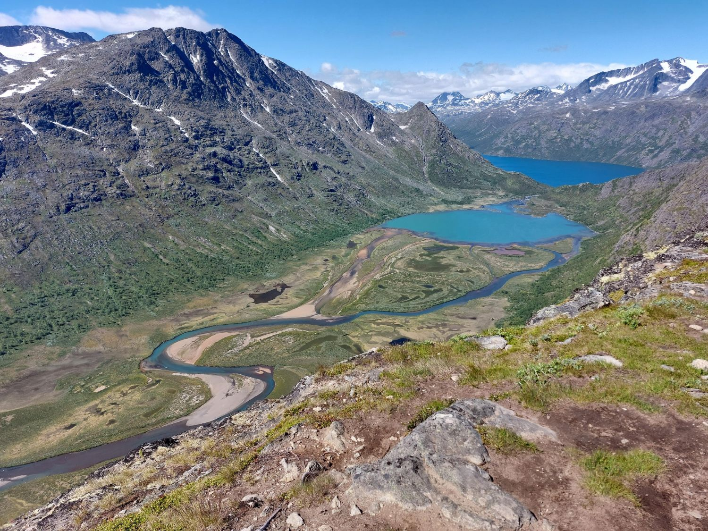

::: {#home .hero}

::: {.hero-photo}
{fig-alt="Portrait of Tadeas Cely"}
:::

::: {.hero-text}
[On the job market]{.hero-badge}

```{=html}
<h1 class="hero-name">Tadeas Cely</h1>
```

[Postdoctoral Researcher · Aarhus University]{.hero-subtitle}

I am a postdoctoral researcher at Aarhus University, where I work on the project *Advertising Democracy*. My research focuses on political disagreement and its democratic resolution — explaining political complexity through belief systems and the interdependence among attitudes, to address some of today's most pressing issues. I am committed to promoting constructive, peaceful politics and countering democratic backsliding, with a focus on Western democracies including those of Central and Eastern Europe.

::: {.hero-links}
[ Email](mailto:tadeascely@ps.au.dk){.btn .btn-primary}
[ CV](Tadeáš_Celý___Curriculum_Vitae.pdf){.btn .btn-outline-primary}
:::
:::

:::

## Formative Experiences {#experience}

::: {.timeline}
- **Aarhus University** · Postdoctoral Researcher · *current*\
  [EPOVB Early-Career Fellowship (APSA)]{.timeline-note}
- **University of Zurich** · Visiting Researcher\
  [Department of Political Science]{.timeline-note}
- **Dartmouth College** · Fulbright Fellow\
  [Polarization Research Lab · Department of Government]{.timeline-note}
- **University of Vienna** · AKTION Fellow\
  [Department of Government]{.timeline-note}
- **Masaryk University** · PhD studies in Czechia\
  [Jacques Rupnik Prize (EUI) · Vice-Rector's Award for Excellent PhD Students]{.timeline-note}
:::

### Personal

I am married with one child. Outside of work I enjoy hiking, cycling, camping, and occasionally playing the violin. If you share any of my interests, feel free to reach out — I am particularly open to junior scholars from underrepresented groups and regions.

::: {.personal-cards}

::: {.personal-card .book-card}
{fig-alt="Cover of The Sympathizer by Viet Thanh Nguyen"}

[Latest read]{.card-label}\
**The Sympathizer**\
Viet Thanh Nguyen
:::

::: {.personal-card .hike-card}
[{fig-alt="View from Knutshøe over a winding river, Øvre Leirungen and lake Gjende in Jotunheimen"}](pictures/knutshoe.jpg)

[Latest hike]{.card-label}\
**Knutshøe**\
Jotunheimen, Norway
:::

:::

## Research {#research}



## Teaching {#teaching}



## Service {#service}


